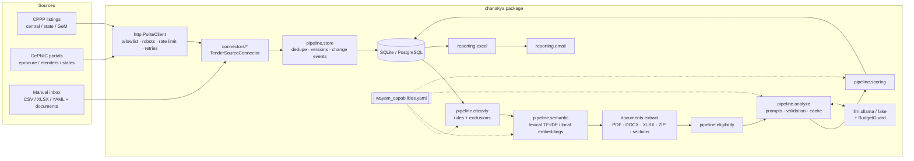
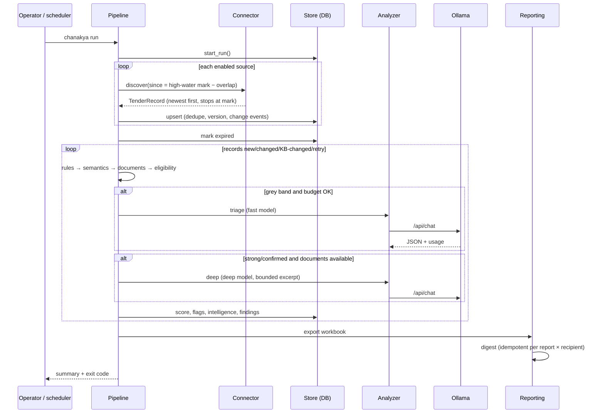

# 06 — System Architecture

A modular monolith: one Python package, one process per run, one database. Each stage is a module
with a narrow contract so that acquisition, filtering, inference and delivery can change independently.

## Component diagram

## Run sequence

## Data flow and cost gates

| Gate | Input | Decision | Cost |
|---|---|---|---|
| Listing parse | Portal page | Records newer than high-water mark | network only |
| Content hash | Record | Unchanged → skip all further work | 0 |
| Rules | Title, category, org, description | REJECTED / LOW / CANDIDATE / STRONG | 0 |
| Semantics | LOW and above | Promote LOW→CANDIDATE (not if excluded) | 0 |
| Documents | CANDIDATE/STRONG only | Parse ≤3 docs × ≤80 pages, sections | CPU |
| Triage | Combined score in [0.20, 0.50) | Fast model yes/no/unclear | ≈$0.0001 |
| Deep | Score ≥0.45 or triage yes, **and** ≥200 chars context | Deep model scope/eligibility | ≈$0.001 |
| Cache | (input, model, prompt, KB version) | Reuse analysis | 0 |
| Budget | Every call | Refuse when a limit would be exceeded | 0 |

## Component responsibilities

| Module | Responsibility | Must not |
|---|---|---|
| `config` | Typed settings from YAML; secrets from env | Hold secrets |
| `http` | Safe, polite fetching | Bypass robots/CAPTCHA, follow off-allowlist redirects |
| `connectors/*` | Fetch + parse + normalise one portal | Filter, call LLMs, write DB |
| `pipeline.store` | Identity, dedupe, versions, change events, expiry | Assess relevance |
| `pipeline.classify` / `semantic` | Free relevance signals | Call paid APIs |
| `documents.extract` | Text with page provenance, sections, excerpts | Send whole documents anywhere |
| `pipeline.eligibility` | Requirements + assessment vs profile | Assume credentials |
| `pipeline.analyze` + `llm/*` | Bounded, validated, cached, budgeted LLM calls | Trust model output unvalidated |
| `pipeline.scoring` | Deterministic score, priority, flags | Use an LLM |
| `reporting/*` | Workbook, digest, delivery log | Re-run scans on email failure |
| `cli`, `app` | Wiring, exit codes, scheduling | Business logic |

## Key decisions and trade-offs

1. **Modular monolith over services** — one daily batch of a few thousand records; services would add
   deployment and failure modes without benefit. Trade-off: scaling beyond one host needs Postgres +
   per-source workers (Phase 6), which the stage boundaries already allow.
2. **Synchronous HTTP, polite by design** — throughput is bounded by politeness (≥3 s/host), not
   concurrency. Async would not shorten runs without hammering portals.
3. **Rules first, LLM last** — deterministic stages are free, explainable and testable; the LLM resolves
   ambiguity and reads documents. Trade-off: the KB needs curation (it is YAML so BD can edit it).
4. **Lexical semantics by default** — zero cost and no model dependency; benchmark shows full funnel
   recall. Local embeddings remain a configuration switch for paraphrase-heavy cases.
5. **Listing-first, documents on demand** — portals put documents behind CAPTCHAs; deep analysis waits
   for imported documents instead of guessing from a title (state `deferred_no_documents`).
6. **SQLite for MVP** — zero ops, WAL mode, online backup. Trade-off: single writer; Postgres URL swap
   for concurrent use.
